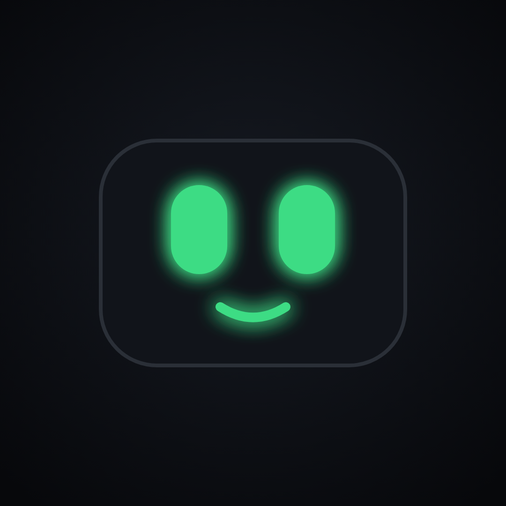
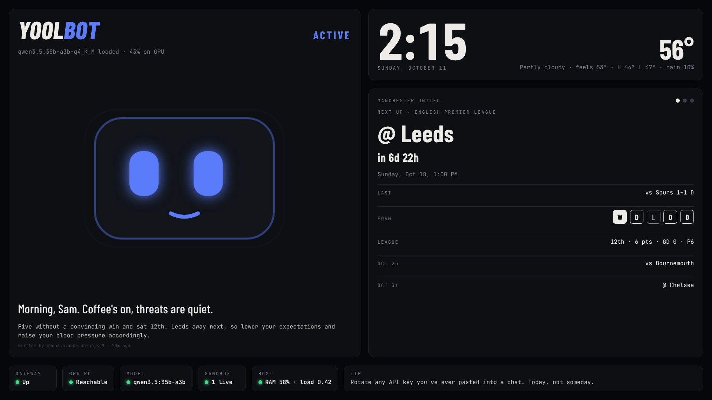
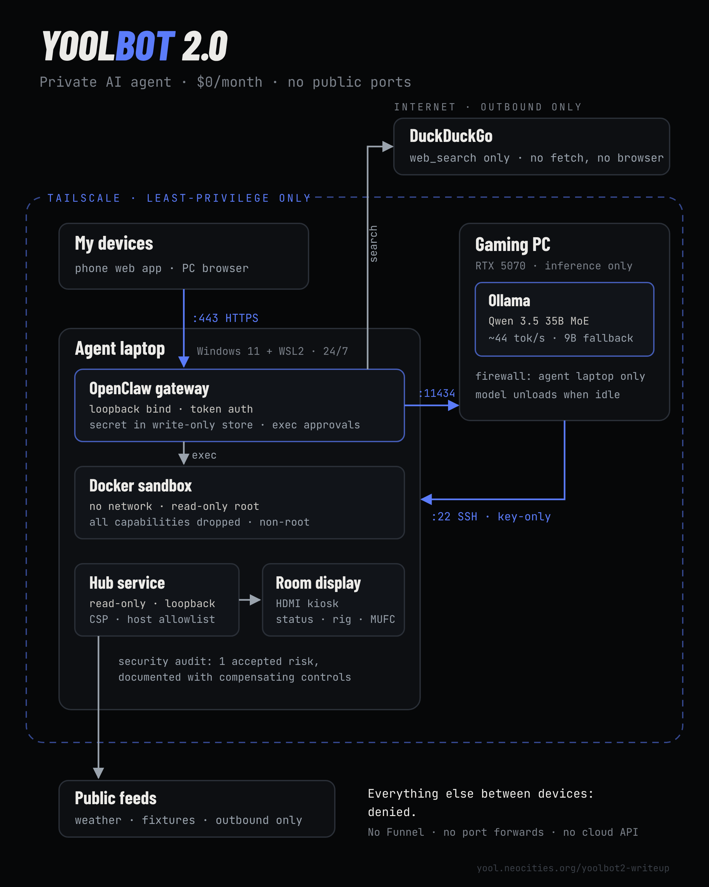
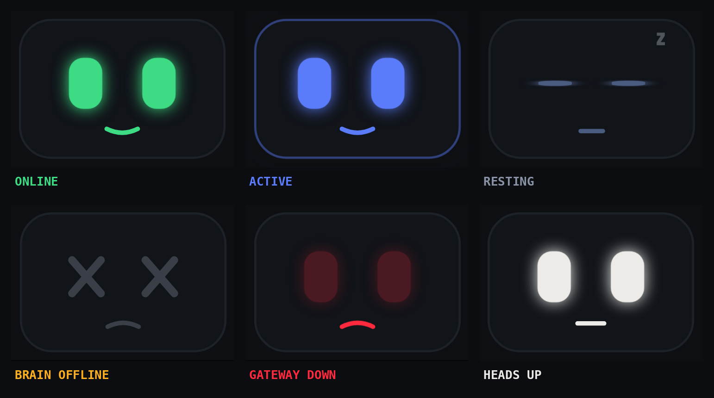
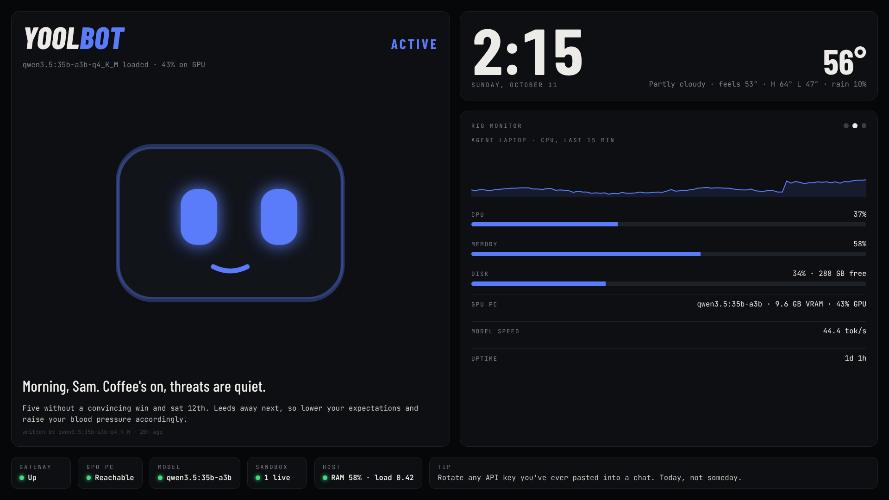
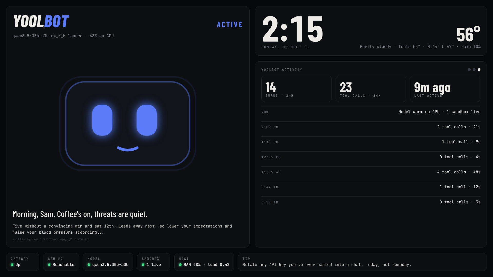

# YOOLBOT 2.0

> A private, hardened AI agent that runs entirely on my own hardware: a local LLM on a gaming PC, an always-on agent laptop, and a room display with a face. **$0/month. No public ports. No cloud LLM.**

---

## What it is

YOOLBOT is my personal AI agent and home-lab project. v1 was a cloud-model chatbot behind a Telegram relay. **v2 brings everything home:** the model runs locally, the agent is sandboxed, and the only way in is a private Tailscale network.

It's built around one assumption: **a small local model will eventually be prompt-injected.** So the model never gets network access, can't change its own instructions, and can only write to two folders. The worst case is a wrong sentence on my screen.

## What it does

| | |
|---|---|
| **Morning brief** | Weather, Man United, and the top security news, on the room screen by 06:45 |
| **Room display** | A face that shows system state, plus live fixtures, rig stats and agent activity |
| **Fantasy picks** | Reads my ESPN league and posts waiver adds every Tuesday |
| **Build loop** | Works through a backlog of security tools on its own, three times an evening: code, tests, commit |
| **RE toolbox** | radare2, binwalk, YARA, gdb, capstone, lief, all offline in the sandbox |
| **Ops agent** | Claude Code reviews the build loop's work nightly and is on call from my phone |

## Architecture

- **Gaming PC (RTX 5070, 12 GB):** Ollama only. `qwen3-coder:30b` (MoE, split across VRAM and RAM) with a 9B fallback. Sleeps at night and wakes itself for the morning jobs.
- **Agent laptop (WSL2, always on):** OpenClaw gateway on loopback, a Docker sandbox for every tool call, the hub service, and the kiosk display.
- **Tailscale** with least-privilege grants: three allowed paths in total, everything else denied.

Details: [docs/architecture.md](docs/architecture.md)

### The design rule

> **Facts come from code. Judgment comes from the model.**

Scores, fantasy data, weather and GPU stats are fetched by plain code the model can't touch. The model reads them from a read-only folder and writes short text for the screen. A prompt injection can't fake a score or a sensor reading.

## Security posture

| If this happens | This stops it |
|---|---|
| Malicious search result | Snippets only: `web_fetch` and `browser` denied, and the sandbox has no network |
| Agent runs a harmful command | Docker sandbox: read-only root, all caps dropped, non-root |
| It rewrites its own instructions | Workspace mounted read-only. Only `/screen` and `/projects` are writable |
| Lateral movement | Tailscale grants + firewall rules allow exactly three paths |
| Someone tries to get in | No public ports, no Funnel. Gateway on loopback. SSH key-only |
| Bad plugin or data feed | 5 of 66 plugins allowed. The GPU reporter returns numbers only |
| Fake text on the screen | Plain-text rendering, size caps, expiry, symlinks refused, and the agent can't trigger red/amber |

`openclaw security audit`: 0 warnings, 1 accepted and documented risk. Full write-up: [docs/threat-model.md](docs/threat-model.md)

## It has a face

Colors keep one meaning each. Red means a real failure, and nothing on the screen is ever red for decoration. The agent can post messages and moods, but only health checks can change the system state.

| Rig view | Agent view |
|---|---|
|  |  |

## Repo layout

| Path | What |
|---|---|
| [`hub/`](hub) | Room display: stdlib Python server + single-page UI + self-contained installer |
| [`pc/`](pc) | Gaming PC helpers: read-only GPU reporter and its locked-down installer |
| [`laptop/`](laptop) | Kiosk helper (cursor parking) |
| [`toolbox/`](toolbox) | Sandbox image (languages, test/lint, RE tools) and the projects repo |
| [`automations/`](automations) | The scheduled-job prompts and what made them reliable |
| [`projects/`](projects) | The build loop's backlog: 40+ offline, defensive tool ideas |
| [`ops/`](ops) | Claude Code as the maintainer: permissions, Remote Control, nightly review |
| [`docs/`](docs) | [Architecture](docs/architecture.md) · [Threat model](docs/threat-model.md) · [Setup](docs/setup.md) · [Lessons](docs/lessons.md) |

## What this repo does not contain

- OpenClaw config, tokens, keys or the secret store
- IP addresses, tailnet names, hostnames or account IDs (placeholders like `<LAPTOP_TAILSCALE_IP>` instead)
- Conversation logs, session data or the agent's workspace

## Lessons

Every bug taught something. My favourite: a "timeout" that was really a CUDA crash after the PC woke from sleep. The full list is in [docs/lessons.md](docs/lessons.md).

## Roadmap

- [ ] Everything recovers on its own after a reboot or sleep (WSL at boot, Ollama health check after wake)
- [ ] IoT bridge for old devices through an MQTT topic allowlist
- [ ] Prompt-injection test lab against my own agent
- [ ] Allowlisted page fetch, so it can read sources safely
- [ ] Package it: a one-command, secure-by-default installer that detects the GPU and picks the model

## v1 (retired)

The first YOOLBOT ran OpenClaw on a freshly wiped laptop with **Gemini Flash** as the model and **Telegram** as the interface, relayed through a VPS so my home IP was never exposed. It ran as a non-root user with UFW default-deny, secrets in a `chmod 600` `.env`, and 2FA on the Telegram account. v2 dropped the cloud model and the relay entirely: the agent now lives behind Tailscale, and the model runs on my own GPU.

## Links

- **Portfolio:** [yool.neocities.org](https://yool.neocities.org)
- **GitHub:** [github.com/samfiera](https://github.com/samfiera)

---

*Part of the YOOL project — Your Own Ongoing Legacy.*
