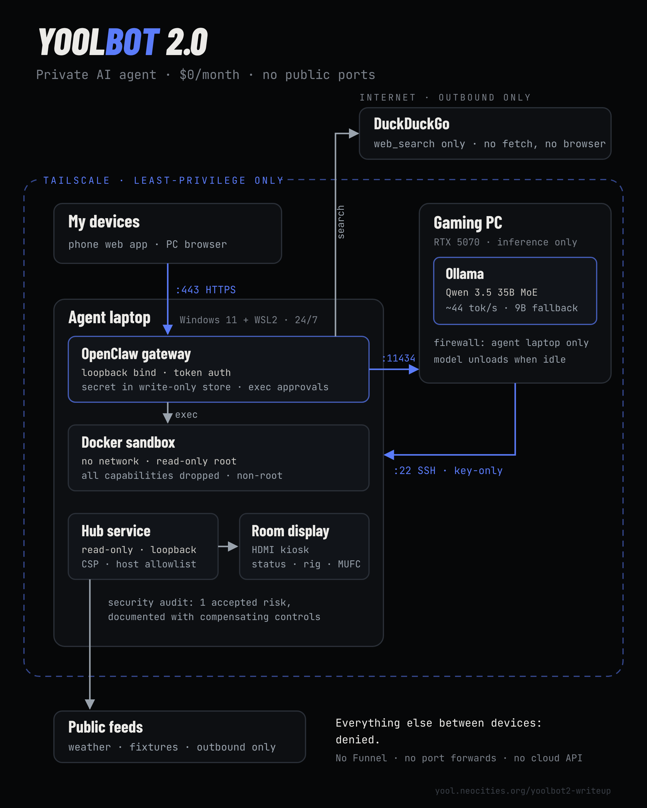
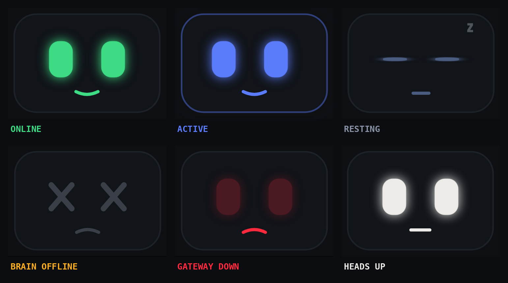

# Architecture

> The diagram is from the first v2 build, when the primary model was Qwen 3.5 35B. The primary is now `qwen3-coder:30b`, with `qwen3.5:9b` as fallback.

## Machines

| Machine | Role | Runs |
|---|---|---|
| **Agent laptop** (Windows 11 + WSL2 Ubuntu 24.04, always on) | Brain stem | OpenClaw gateway, Docker sandbox, hub service, room display (HDMI kiosk), Claude Code ops agent |
| **Gaming PC** (RTX 5070 12 GB, 32 GB RAM) | Inference only | Ollama, read-only GPU reporter. Sleeps nightly and wakes on a schedule |
| **My devices** (phone, desktop browser) | Clients | OpenClaw web UI over Tailscale, Claude app for the ops agent |

Everything talks over **Tailscale** with least-privilege grants. Nothing listens on the public internet.

## Network paths

Only these paths are allowed. Everything else between devices is denied.

| From | To | Port | Why |
|---|---|---|---|
| My devices | Agent laptop | 443 (Tailscale Serve) | OpenClaw web UI |
| Agent laptop | Gaming PC | 11434 | Ollama API |
| Agent laptop | Gaming PC | 11435 | GPU stats (numbers only) |
| Gaming PC | Agent laptop | 22 | SSH, key-only, for admin |

Outbound to the internet: DuckDuckGo search (agent), plus public weather and ESPN feeds fetched by the hub's own code. The agent sandbox has no network at all.

## Components

### OpenClaw gateway
- Bound to loopback, token auth, published to the tailnet with Tailscale Serve.
- 5 of 66 plugins allowed: `ollama`, `duckduckgo`, `memory-core`, `device-pair`, `document-extract`.
- `web_fetch` and `browser` denied for every model (`tools.byProvider`). The agent sees search snippets, never full pages.
- Secrets live in OpenClaw's write-only secret store, not in config files.

### Sandbox
Every agent tool call runs in Docker:

| Setting | Value |
|---|---|
| mode | all (every session) |
| workspace access | read-only |
| network | none |
| root filesystem | read-only |
| capabilities | all dropped, non-root user |
| image | `yoolbot-toolbox:3` ([toolbox](../toolbox/setup-toolbox.sh)) |
| writable binds | `/screen` (room display), `/projects` (build loop) |
| read-only binds | `/data` (facts fetched by the hub) |

### Models (Ollama on the gaming PC)
- `qwen3-coder:30b` primary (MoE, ~3B active per token, split about half VRAM / half RAM), `qwen3.5:9b` fallback.
- `OLLAMA_FLASH_ATTENTION=1`, `OLLAMA_KV_CACHE_TYPE=q8_0`, `OLLAMA_KEEP_ALIVE=2h`, 64K context.
- Firewall allows the Ollama port from the agent laptop only.

### Hub ([`hub/`](../hub))
A small Python service on the laptop (`127.0.0.1:8787`, systemd user unit) that drives the room display.

- **Read-only.** It never writes to the agent's workspace except `/data`, which it owns.
- **Facts from code:** weather (Open-Meteo), Man United fixtures and table (ESPN, six competitions), fantasy league (ESPN public league, every 3 h), rig stats (local CPU/RAM/disk plus the PC's GPU reporter), agent activity (OpenClaw session logs).
- **Judgment from the model:** the agent writes short text files to `/screen`, and the hub renders them as plain text.
- Host-header allowlist (blocks DNS rebinding), strict CSP, `nosniff`, `python3 -I`.
- Views rotate: brief, United, fantasy, builds, rig, agent.

#### Screen file contract

| File | Written by | Expires | Shows |
|---|---|---|---|
| `now.json` `{"text","mood","ttl_min"}` | agent, any time | `ttl_min` | message + face mood (`idle`, `happy`, `thinking`, `alert`) |
| `brief.md` | morning brief | 18 h | brief view |
| `fantasy.md` | waiver job | 4 days | fantasy view |
| `builds.md` | build loop | 3 days | builds view |

Text is capped and rendered as text, never HTML. Symlinks are refused. The agent can pick a mood, but it can never put the screen into a system state (red/amber). Only health checks can do that.

#### Faces

Colors keep one meaning each: **green** online, **blue** model warm/working, **amber** degraded (PC asleep), **red** real failure only, **white** the agent wants attention. Nothing is red or amber decoratively.

### Ops agent ([`ops/`](../ops))
Claude Code on the laptop, using my Claude subscription:
- **Remote Control** session I can drive from the Claude app on my phone.
- **Nightly review** at 23:30: health check, review and test the build loop's commits, fix backlog drift, log a summary.
- It runs outside the OpenClaw sandbox, so it has a strict permission file: no reading secrets or SSH keys, no `git push`, `sudo`, `ssh` or Tailscale changes, and it has to ask before editing configs or restarting services.

## Schedule

| Time | What |
|---|---|
| 06:38 weekdays / 08:53 weekends | Gaming PC wakes (scheduled task with WakeToRun) |
| 06:45 weekdays | Morning brief → screen |
| 06:55 Tuesday | Fantasy waiver picks → screen |
| every 30 min | Heartbeat |
| 18:00, 20:00, 22:00 | Build loop |
| 23:00–07:00 | Display dims, face rests |
| 23:30 | Claude Code nightly review |
| night | Gaming PC sleeps (heat/PSU) |
